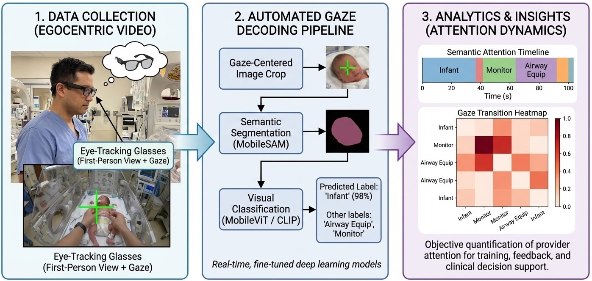

# Vision-language Models for Decoding Provider Attention During Neonatal Resuscitation

[](https://openaccess.thecvf.com/content/CVPR2024W/CVPM/html/Parodi_Vision-language_Models_for_Decoding_Provider_Attention_During_Neonatal_Resuscitation_CVPRW_2024_paper.html)

Training code for the computer vision models for neonatologist attention tracking.

## Authors
**Felipe Parodi**, Jordan K. Matelsky, Alejandra Regla-Vargas, Elizabeth E. Foglia, Charis Lim, Danielle Weinberg, Konrad P. Kording, Heidi M. Herrick, Michael L. Platt



## Abstract

Neonatal resuscitations demand an exceptional level of attentiveness from providers who must process multiple streams of information simultaneously. Gaze strongly influences decision making; thus understanding where a provider is looking during neonatal resuscitations could inform provider training, enhance real-time decision support, and improve the design of delivery rooms and neonatal intensive care units (NICUs). Current approaches to quantifying neonatal providers' gaze rely on manual coding or simulations, which limit scalability and utility. Here we introduce an automated real-time deep learning approach capable of decoding provider gaze into semantic classes directly from first-person point-of-view videos recorded during live resuscitations. Combining state-of-the-art real-time segmentation with vision-language models, our low-shot pipeline attains 91% classification accuracy in identifying gaze targets without training. Upon fine-tuning, the performance of our gaze-guided vision transformer exceeds 98% accuracy in semantic gaze analysis, approaching human-level precision. This system, capable of real-time inference, enables objective quantification of provider attention dynamics during live neonatal resuscitation. Our approach offers a scalable solution that seamlessly integrates with existing infrastructure for data-scarce gaze analysis, thereby offering new opportunities for understanding and refining clinical decision making.

## Gaze Classes

| Class ID | Class Name |
| :------: | :--------: |
| 0 | Airway-Equipment |
| 1 | CMAC-Screen |
| 2 | Infant |
| 3 | Non-Team-Member |
| 4 | Other-Physical-Objects |
| 5 | Airway-Provider |
| 6 | Vitals-Monitor |

## Repository Contents

| Directory | Description |
|-----------|-------------|
| `/configs` | Configuration files for each deep learning model |
| `/data` | Example annotation files for testing |
| `/notebooks` | Jupyter Notebooks for data preprocessing and model testing |
| `/results` | Results and figures |
| `/src` | Helper functions and source code |

## Citation

If you use this code or find our work helpful, please cite:

```bibtex
@inproceedings{parodi2024vision,
  title={Vision-language models for decoding provider attention during neonatal resuscitation},
  author={Parodi, Felipe and Matelsky, Jordan K and Regla-Vargas, Alejandra and Foglia, Elizabeth E and Lim, Charis and Weinberg, Danielle and Kording, Konrad P and Herrick, Heidi M and Platt, Michael L},
  booktitle={Proceedings of the IEEE/CVF Conference on Computer Vision and Pattern Recognition},
  pages={343--353},
  year={2024}
}
```
